<div align="center">

# Scarlet

**Un inicio de consola para la ROG Xbox Ally X, con el estilo de la Switch 2.**

Tus juegos de Steam, Xbox y los que agregues tú, en una pantalla hecha para el mando.
Un toque al botón Xbox abre el menú rápido encima de cualquier juego.

[](https://github.com/Yonisjpa/Scarlet/actions/workflows/build.yml)
[](https://github.com/Yonisjpa/Scarlet/releases/latest)


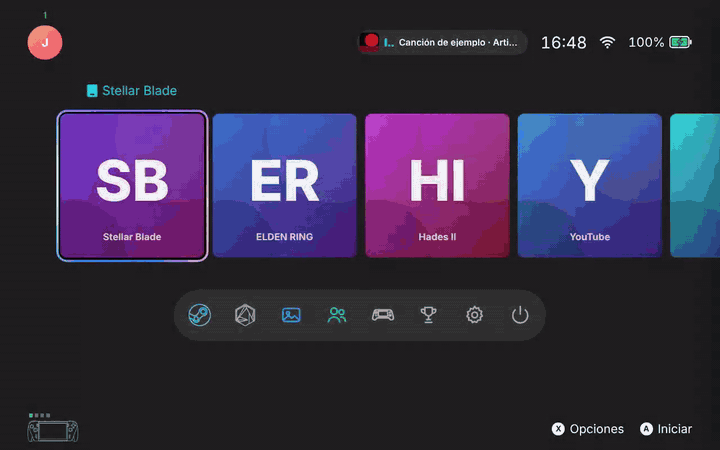

</div>

---

## Así se ve

<table>
  <tr>
    <td width="50%">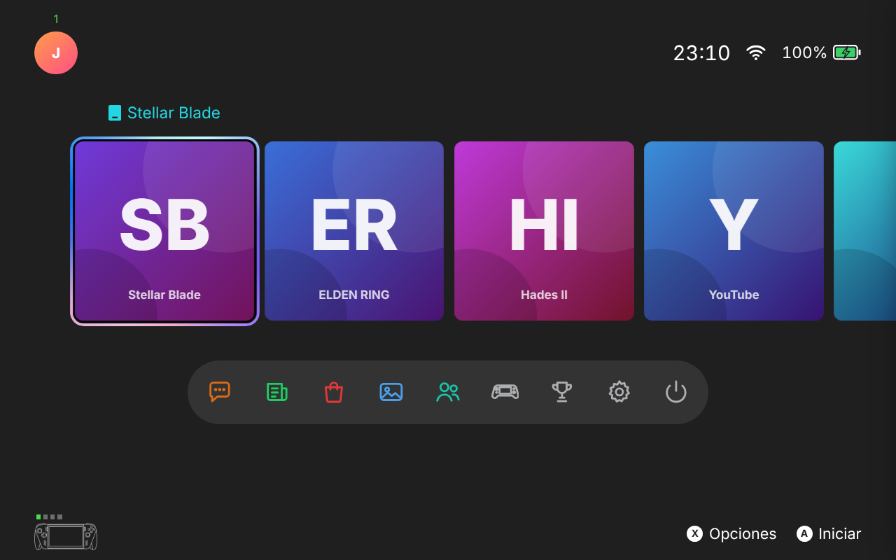<br><sub><b>Inicio</b> · tus juegos recientes; abajo Steam, Armoury Crate, Álbum, Amigos…</sub></td>
    <td width="50%">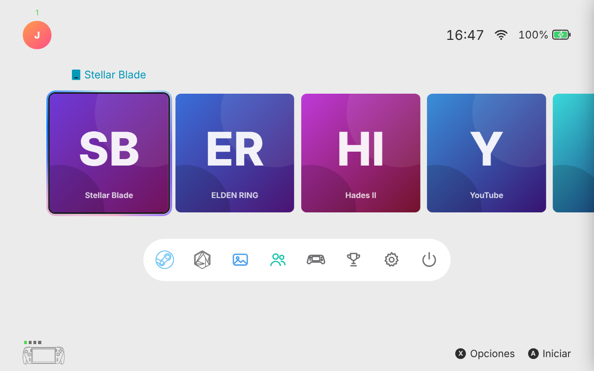<br><sub><b>Tema claro</b> · o automático, como Windows</sub></td>
  </tr>
  <tr>
    <td>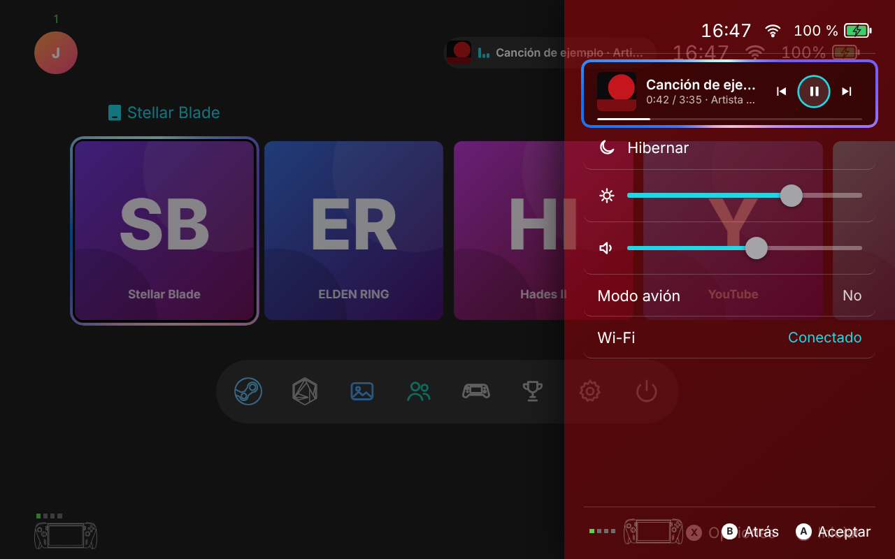<br><sub><b>Menú rápido</b> · la canción que suena, brillo, volumen, Wi-Fi… con el fondo al 50 %</sub></td>
    <td>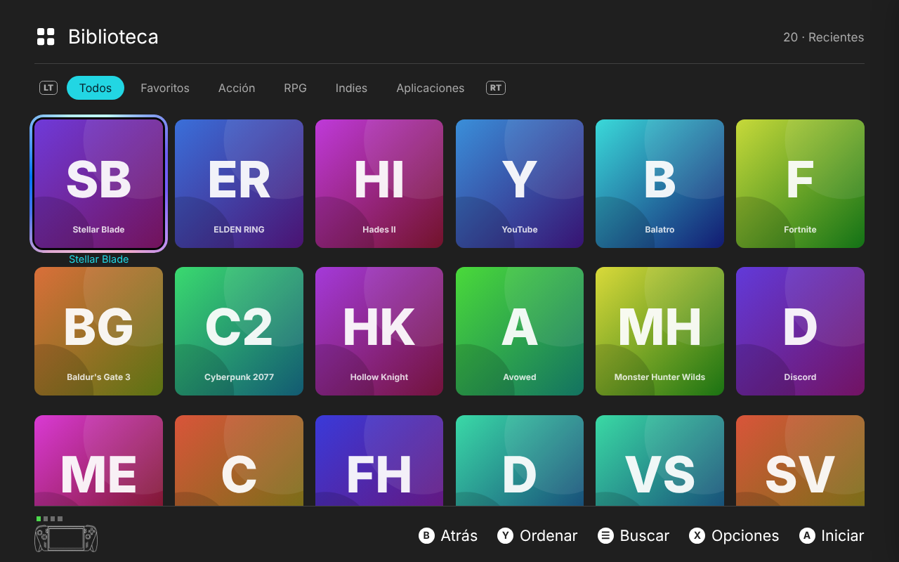<br><sub><b>Biblioteca</b> · tus colecciones de Steam, orden y búsqueda</sub></td>
  </tr>
  <tr>
    <td>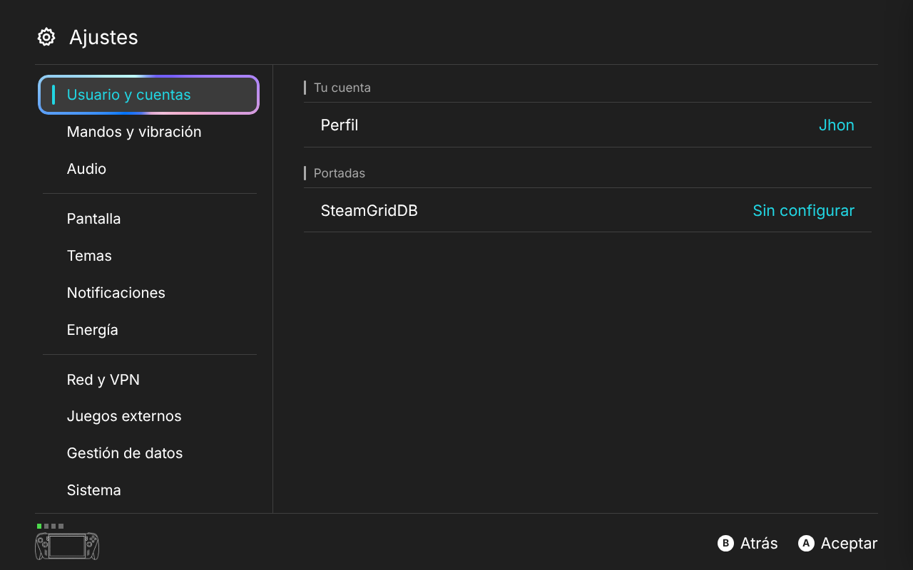<br><sub><b>Ajustes</b> · categorías a la izquierda, opciones a la derecha</sub></td>
    <td>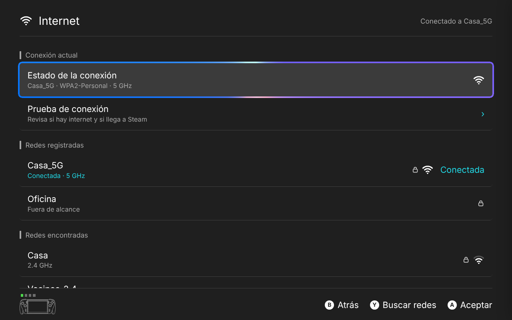<br><sub><b>Internet</b> · redes, contraseña y prueba de conexión sin salir</sub></td>
  </tr>
  <tr>
    <td>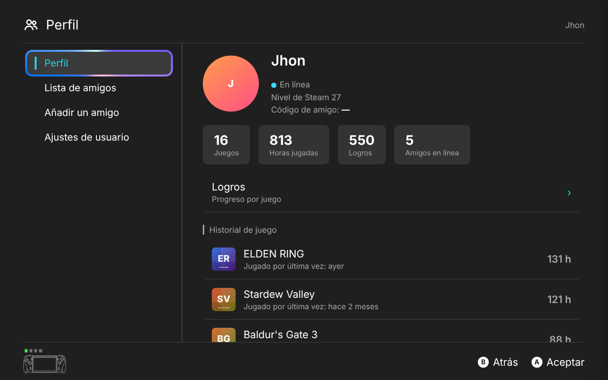<br><sub><b>Perfil</b> · código de amigo e historial de juego</sub></td>
    <td>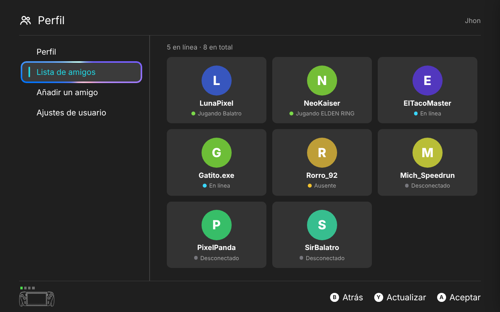<br><sub><b>Amigos</b> · tarjetas, ★ mejores amigos primero</sub></td>
  </tr>
  <tr>
    <td colspan="2">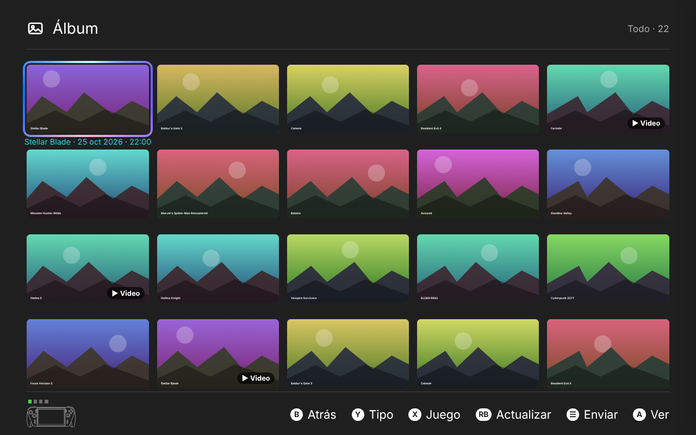<br><sub><b>Álbum</b> · capturas y videos de la Game Bar y de Steam</sub></td>
  </tr>
</table>

<sub>Capturas de la demo, con juegos y portadas de ejemplo.</sub>

## Qué hace

| | |
|---|---|
| 🎮 **Biblioteca** | Steam (instalados, tu cuenta y tus colecciones), Xbox Store / Game Pass y juegos externos (.exe, .lnk, .url: emuladores u otras tiendas). Portadas de SteamGridDB o las oficiales. |
| ▶️ **Jugar** | Pantalla de carga hasta que el juego está en pantalla, «En uso» en su mosaico, horas jugadas; al volver al Inicio el juego se calla (y se pausa, si lo marcas en sus opciones). Al entrar o salir de un juego ves su fondo y su logo, y los dos se eligen en sus opciones (X). |
| ⚡ **Menú rápido** | Un toque al botón Xbox, encima de cualquier juego: la canción que suena (con los colores de su carátula), hibernar, brillo, volumen general y de cada app, modo avión, Wi-Fi y VPN. |
| ☁️ **Nube de Steam** | Cuando un juego sube su partida, su mosaico lo muestra como descarga naranja; si otro juego tiene que esperar, la pantalla de carga lo dice. |
| ⬇️ **Descargas** | Progreso en vivo, pausar, cancelar, instalar y desinstalar sin las ventanas de Steam. |
| 📶 **Internet** | Redes registradas y encontradas, conectarse con contraseña, prueba de conexión, estado y olvidar redes. VPN con Cloudflare WARP o WireGuard. |
| 👥 **Perfil y amigos** | Tu código de amigo, historial de juego, amigos en línea y jugando, ★ mejores amigos, buscar por código. |
| 🖼️ **Álbum** | Capturas y videos de la Game Bar (Videos › Capturas) y de Steam; recortar, borrar y mandar al celular con un QR. |
| 🔔 **Avisos** | Logros, amigos, descargas y batería. Mientras juegas solo lo importante; lo demás te espera en «Mientras jugabas». |
| 👆 **Pantalla táctil** | Toca para elegir y otra vez para abrir, desliza la fila y las listas, desliza desde la orilla izquierda para regresar, deja el dedo sobre un juego para sus opciones y toca las ayudas de abajo («B Atrás», «A Aceptar»…). |
| 🧭 **Barra de abajo** | Steam (abre Big Picture: biblioteca, tienda y amigos), Armoury Crate, Álbum, Amigos, Controles, Logros, Ajustes y Apagar. |
| 🔋 **Ligero mientras juegas** | Con el menú cerrado, Scarlet se congela y pasa a modo eficiencia de Windows. Diagnóstico › Rendimiento muestra cuánto usó. |

## Instalar

1. Descarga **`Scarlet-win-x64.zip`** de la [última versión](https://github.com/Yonisjpa/Scarlet/releases/latest).
2. Descomprímelo en una carpeta fija, por ejemplo `C:\Juegos\Scarlet`.
3. Abre **`Scarlet.exe`**.

No hay que instalar nada más: trae todo lo que necesita.

**Actualizar:** Ajustes › Sistema › Buscar actualizaciones. Si una versión nueva no abriera dos veces seguidas, Scarlet regresa sola a la anterior.

## La primera vez

En **Ajustes › Usuario y cuentas › Cuentas y arranque**, con el mando:

- **SteamID64:** se detecta solo.
- **API key de Steam** (para tu biblioteca completa, amigos y logros): sácala en <https://steamcommunity.com/dev/apikey>. En «dominio» pon cualquier cosa, por ejemplo `localhost`. En Steam › tu perfil › Privacidad, deja **Perfil** y **Detalles de juego** en **Público**.
- **API key de SteamGridDB** (opcional, portadas cuadradas): <https://www.steamgriddb.com/profile/preferences/api>.
- ☑ **Abrir Scarlet al iniciar sesión** y ☑ **Quitarle el botón Xbox a la Game Bar.**

Las claves se guardan cifradas con tu usuario de Windows, solo en tu equipo.

Y en **Steam**, una sola vez:

- Ajustes › Mando › apaga **«El botón Guía enfoca Steam»** (si no, Big Picture se roba el botón Xbox).
- Ajustes › Interfaz › apaga **«Iniciar Steam en modo Big Picture»**.

<details>
<summary><b>Que la consola arranque directo en Scarlet (en vez de la app de Xbox)</b></summary>

<br>

Windows solo deja elegir apps registradas como «app de inicio» del modo Xbox. La forma sencilla y reversible:

1. Instala **AnyFSE** desde Microsoft Store (gratis, código abierto).
2. En su configuración, **Choose home app › Custom / Browse** y elige `Scarlet.exe`. En la detección pon el proceso `Scarlet`.
3. Windows › Configuración › Juegos › **Experiencia de pantalla completa** › **App de inicio**: elige **AnyFSE**.
4. Reinicia: la Ally arranca en modo Xbox, pero lo que aparece es Scarlet.

Para deshacerlo, vuelve a elegir la app de Xbox como app de inicio.

</details>

## Controles

| Botón | En el Inicio y los menús |
|---|---|
| **A / B** | Aceptar / atrás |
| **X** | Opciones del juego (portada, grupos, compatibilidad…) |
| **Y** | Ordenar, tipo, buscar redes o actualizar, según la pantalla |
| **☰ Menú** | Buscar en la biblioteca · Listo en el teclado |
| **LB / RB · LT / RT** | Saltar en la fila · cambiar de colección |
| **Xbox, un toque** | Menú rápido, encima de lo que esté abierto (también de un juego) |
| **Xbox, dos toques** | Al Inicio; otra vez, de regreso al juego |
| **Xbox, mantener** | Las ventanas abiertas de Windows |
| **View + Menú** | Respaldo del botón Xbox: tocar = Inicio / juego · mantener = menú rápido |

Las capturas se toman con la Game Bar o con Steam y aparecen al instante en el Álbum.

**Con el dedo:** un toque elige y otro abre · deslizar mueve la fila y las listas · desde la orilla izquierda hacia la derecha = Atrás · dejar el dedo sobre un juego = sus opciones (en el Álbum, empezar a elegir) · las ayudas de abajo también se tocan.

## Si algo falla

- **Ajustes › Sistema › Diagnóstico** muestra lo que Scarlet ve en ese momento: el juego, las apps con sonido, Steam, la música y el rendimiento.
- El registro está en `log.txt`, junto a `Scarlet.exe`. Ahí queda cada paso: botón Xbox, juegos, nube, Wi-Fi.
- Para inspeccionar la interfaz: en `%APPDATA%\Scarlet\config.json` pon `"DevTools": true`, reinicia y presiona F12.

**Límites conocidos**

- En juegos con **pantalla completa exclusiva**, el menú y los avisos no se pueden dibujar encima (Scarlet ofrece hacerlos compatibles).
- Steam no deja cambiar desde fuera «El botón Guía enfoca Steam»; si Big Picture aparece con el botón Xbox, Scarlet lo cierra y te dice dónde apagarlo.
- En Windows 11 24H2, Windows solo enseña las redes Wi-Fi de alrededor si las apps de escritorio tienen permiso de ubicación.
- Las solicitudes de amistad recibidas y enviadas se ven en Steam: Scarlet todavía no puede leerlas.

## Cómo está hecho

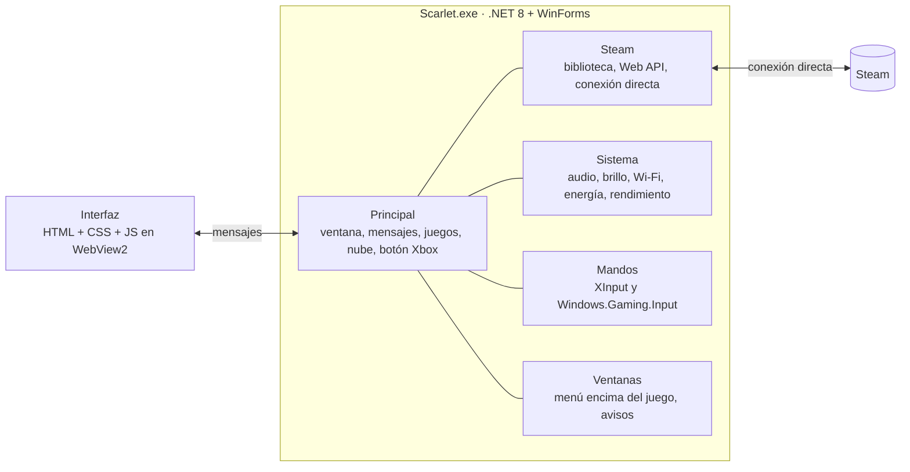

- **La interfaz** es una página web (WebView2) que vive en `ui/`, repartida por áreas: `ui/js/` (inicio, menú rápido, ajustes, perfil, Internet…), `ui/css/` y `ui/pagina.html`. `python ui/build.py` la arma en un solo archivo, `web/index.html`, que es el que carga la app.
- **La app de Windows** (`src/`) le da a esa página acceso real a Steam, Windows y los mandos. Cada mensaje de la interfaz (`steam.games`, `wifi.connect`…) lo atiende `src/Principal/MainForm.Mensajes.*.cs`, por tema.

```
src/Principal/   ventana principal, por tema (juegos, nube, botón Xbox, rendimiento, mensajes…)
src/Steam/       Steam local y Web API, conexión directa, juegos de Xbox y externos, portadas
src/Sistema/     audio, música, brillo, energía, Wi-Fi, red y VPN, rendimiento, Windows
src/Mandos/      botón Xbox y mandos
src/Ventanas/    menú rápido encima del juego, avisos, cuentas
ui/              la interfaz (js, css, página, imágenes propias)
tests/           pruebas: interfaz (ui/), lo que corre dentro de Steam (steam/) y descargas (DlTests/)
```

## Compilar y probar

**Compilar en Windows:** instala el SDK de .NET 8 (`winget install Microsoft.DotNet.SDK.8`) y abre `build.cmd`. La app queda en `dist\Scarlet`.

**Probar la interfaz** (en cualquier sistema, con Node 20+ y Python 3):

```bash
cd tests/ui && npm install && npx playwright install chromium
node run.js            # todos los escenarios · node run.js beta12 para uno solo
```

Usa un Windows y un Steam simulados (`tests/ui/host.js`), así que no hace falta la consola. Las pruebas de lo que Scarlet corre dentro de Steam:

```bash
python3 tests/steam/extract.py && node tests/steam/sim.js && node tests/steam/nube.js
```

En cada cambio a `main`, GitHub corre todas las pruebas; si pasan, compila la app y, si la versión del `.csproj` es nueva, publica la versión con las notas de [`NOTAS.md`](NOTAS.md).

## Tus datos

Tu configuración, claves, caché y registro viven en `%APPDATA%\Scarlet` y `%LOCALAPPDATA%\Scarlet`, nunca en este repositorio. Scarlet no manda nada a ningún servidor propio: solo habla con Steam, SteamGridDB, iTunes (carátulas de la música), Microsoft (la prueba de conexión) y GitHub (actualizaciones).

**Desinstalar:** en Cuentas y arranque quita las palomitas, y borra la carpeta de la app, `%APPDATA%\Scarlet` y `%LOCALAPPDATA%\Scarlet`.

---

<sub>Proyecto personal. Scarlet no tiene relación con Nintendo, Microsoft, Xbox, ASUS, ROG ni Valve; sus nombres solo se usan para decir con qué funciona. Todos los derechos reservados.</sub>
